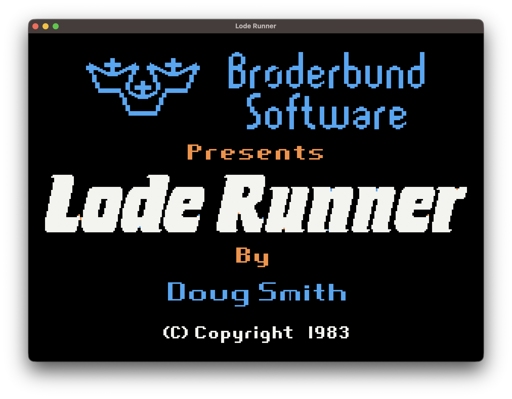
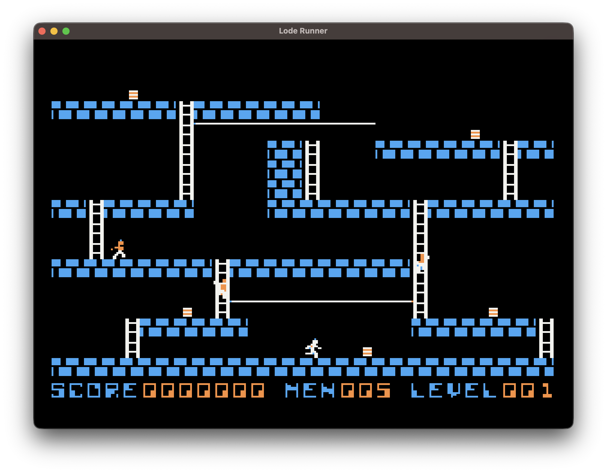

# Lode Runner for macOS

A Swift/AppKit port of the Apple II **Lode Runner** game rules and visual assets. The original reverse engineering material is preserved in [`apple2/`](apple2/); the macOS app and tests build from the repository root.

The main goal is **faithful gameplay progression**: movement, digging, falling, gold collection, guard behavior, brick restoration, death, and level changes should occur in the same order for the same input. The port does not emulate the Apple II memory layout or speaker circuitry cycle by cycle.

## Screenshots

**Title screen**



**Gameplay**



## Build and play

Requires macOS 14 or later and the Xcode Swift toolchain. Open [`LodeRunner.xcodeproj`](LodeRunner.xcodeproj), select the **LodeRunner** scheme, and choose Build or Run. Xcode writes the app to `Build/LodeRunner.app`.

For a Developer ID-signed and notarized GitHub release, follow the [release guide](docs/release.md). Local builds are not distribution signed.

The command line build uses the same output location:

```sh
sh scripts/build-macos-app.sh
open Build/LodeRunner.app
```

Both builds package `levels.bin`, `sprites.bin`, `splash.bin`, and the app icon directly in `Build/LodeRunner.app/Contents/Resources`. The app loads its data files from its own bundle, so it can be moved and launched without the source checkout or Swift build directory. To regenerate the icon from [`Assets/LodeRunnerIcon.png`](Assets/LodeRunnerIcon.png), run `sh tools/make-app-icon.sh`.

Press any key on the title screen to start. After 10 seconds without input, an automatic demo plays the first level; any key during the demo starts a new game. Game Over returns to the title screen after a short pause.

| Action | Keys |
| --- | --- |
| Move | `I J K L`, arrow keys, or `W A S D` |
| Dig left / right | `U` / `O` (`Z` / `X` also work) |
| Pause | Space |
| Start a new game after Game Over | Return |
| Select 1× / 2× / 3× / 4× speed | `⌘1` / `⌘2` / `⌘3` / `⌘4` |

Digging uses physical key positions, so it also works when a non-Latin input method is active. The app starts at 1×, set to 24 game steps per second. This is a playable estimate informed by the original `FRAME_PERIOD=6`, not a measured Apple II+ cycle rate.

## Repository layout

| Path | Contents |
| --- | --- |
| [`Sources/LodeRunnerCore/`](Sources/LodeRunnerCore/) | Level decoding, both boards, player and guard logic, timers, game loop, sprites, and HGR color interpretation |
| [`Sources/LodeRunnerMac/`](Sources/LodeRunnerMac/) | AppKit window, keyboard input, fixed game steps, rendering, and substitute sound cues |
| [`Sources/LevelInspector/`](Sources/LevelInspector/) | Command line level inspection tool |
| [`Tests/`](Tests/) and [`fixtures/`](fixtures/) | Gameplay tests and captured 6502 runtime states |
| [`tools/`](tools/) | Extraction and verification of levels, sprites, and title artwork |
| [`apple2/`](apple2/) | Original reverse engineering document, 6502 assembly, disk sectors, binaries, and build tools |
| [`docs/`](docs/) | [Main logic and I/O map](docs/main_logic_io_map.md), [porting plan](docs/porting_plan.md), and [execution baseline](docs/reference_baseline.md) |

## How the port works

### Game state and execution order

The original zero page mixes long-lived game state with row pointers, guard scratch values, and rendering arguments. The port keeps long-lived values in `GameState`, `PlayerState`, and `GuardState` and uses local calculations for short-lived values. The original active and background boards at `$0800` and `$0A00` remain separate as `activeBoard` and `backgroundBoard`.

One game step starts with the equivalent of `MOVE_PLAYER`, followed by collision and death checks, exit ladder reveal when all gold is gone, level completion, hole and resurrection timers, and guard movement. Digging continues across several steps after an input press. A new hole starts at timer value 180 and reaches 179 during that same outer game step. After level 150, the original loader returns to the first disk level and increases the guard pattern offset; the port follows that progression.

### Original data and display

The 150 levels come from the 256-byte sectors in [`apple2/disk/`](apple2/disk/). The port reads the original 104 sprite bitmaps from [`apple2/sprite_data.asm`](apple2/sprite_data.asm) and expands the compressed title image from [`apple2/main.bin`](apple2/main.bin). Gameplay uses a 28×16 board of 10×11-pixel sprites in a 280×192 image, with original character sprites on the status line.

Colors are derived from HGR bit patterns, not stored as RGB sprite images. Adjacent `11` bits become white; separated bits and each byte's high bit select blue, orange, and the other artifact colors. The macOS window displays the result at an integer scale. It does not reproduce the Apple II's non-linear HGR row addresses, page switching, or NTSC circuitry. RGB values and the iris transition are visual approximations.

### Timing and audio

Display refresh and game steps are separate. `⌘1`–`⌘4` changes the number of game steps per second without changing the rule and timer order inside each step. Short square-wave cues stand in for sound effects; they do not reproduce Apple II speaker toggles or the original note delays.

## Verification and current scope

```sh
swift test --scratch-path /tmp/lode-runner-swift-build
python3 tools/capture_reference.py --check
python3 tools/export_levels.py --check
python3 tools/export_sprites.py --check
python3 tools/export_splash.py --check
```

The tests cover round-trip encoding of all 150 level sectors, captured level-one execution states, movement and digging, guard patterns, carried gold, hole escape, holes, death, exits, and the level-150 boundary. Long input traces across several levels have not yet been compared with the original. The original level editor and high-score persistence are not in the macOS app. Gameplay progression has priority over hardware-level pixel and audio matching.

## Apple II source and attribution

[`apple2/`](apple2/) contains material from [XekriRedmane's Lode Runner reverse engineering project](https://github.com/XekriRedmane/lode_runner_reveng). Its explanatory source is [`apple2/main.nw`](apple2/main.nw), with a rendered version at [`apple2/main.pdf`](apple2/main.pdf). Rebuilding the Apple II assembly and DOS 3.3 disk image requires `dasm`; generating the PDF also requires TeX Live.

```sh
cd apple2
python3 build.py
# To regenerate the PDF, run pdflatex main.tex twice.
```

The original project states the [Creative Commons Attribution-ShareAlike 4.0 International](https://creativecommons.org/licenses/by-sa/4.0/) license. This port retains attribution and uses the same terms. The game name and original game rights belong to their respective owners.
