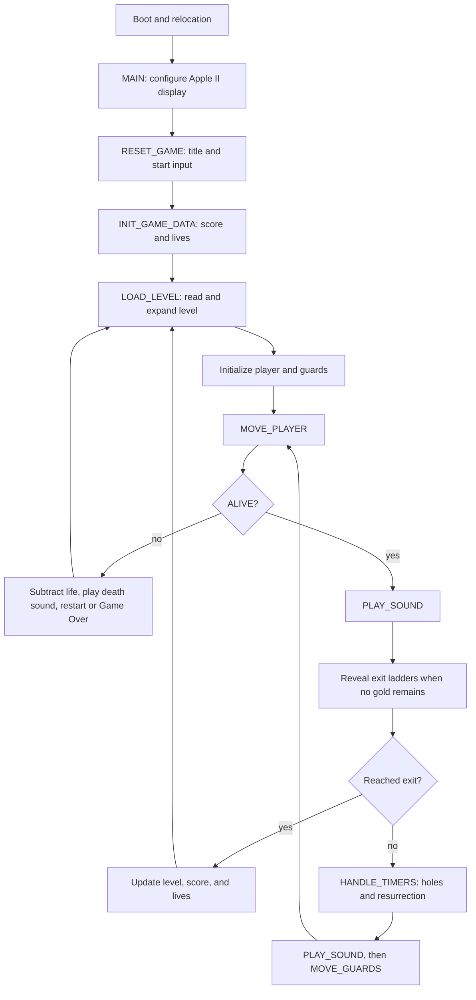

# Main logic and I/O boundaries

This document follows the execution path in [`apple2/main.nw`](../apple2/main.nw) and identifies the state and I/O boundaries needed by the port. Original memory addresses identify roles; they do not prescribe the native data structures.

## Execution path

The actual loop is `INIT_GAME_DATA` and `<<game loop>>` around lines 8800–9010 of `apple2/main.nw`. Death can lead to a title or score screen depending on game mode and remaining lives, so the diagram's `N → E` represents only the restart path. `PLAY_SOUND` occurs twice in a normal loop and may either play a note or delay execution. Its placement affects the original pace.

## Zero page: persistent state and scratch space

The 6502 uses A, X, and Y for short calculations. Zero page acts as pointers, arguments, game state, and extra working registers. A native port must distinguish persistent state from values that live only during a call.

| Address | Original names | Role and lifetime |
| --- | --- | --- |
| `$00`–`$05` | `PLAYER_COL/ROW`, `PLAYER_X/Y_ADJ`, `PLAYER_ANIM_STATE`, `PLAYER_FACING_DIRECTION` | Persistent player cell, within-cell offsets, animation, and facing. Offsets run from 0 to 4; 2 is aligned. |
| `$06`–`$09` | `PTR1`, `PTR2` | Current logical-board row pointers. `PTR1` addresses the active board (`$0800`–`$09BF`), which includes moving objects; `PTR2` addresses the background board (`$0A00`–`$0BBF`). Calls reset these frequently. |
| `$0C`–`$0F` | `ROW_ADDR`, `ROW_ADDR2` | Temporary HGR screen-row pointers. |
| `$12`–`$19` | `GUARD_LOC_*`, `GUARD_*`, `GUARD_NUM` | Working copy of one guard. The full guard array lives near `$0C60`; `LOAD_GUARD_DATA` and `STORE_GUARD_DATA` transfer values. |
| `$1B`–`$1F`, `$50`–`$51`, `$71`, `$DF`–`$FF` | Screen coordinates, `SPRITE_NUM`, `HGR_PAGE`, masks, shifts, `BLOCK_DATA` | Renderer arguments and scratch values. `$DF`–`$FF` form a 33-byte shifted sprite buffer. |
| `$53`–`$64` | Resurrection position, note index, AI scratch values, `GUARD_PATTERNS`, `GUARD_PHASE` | Shared resurrection, AI, and sound storage. `$55`, `$56`, and `$5C` also have aliases in score-screen code. |
| `$85`–`$86` | `GAME_COLNUM/ROWNUM` | Coordinates passed to drawing routines, distinct from the player's persistent position. |
| `$8C`–`$94` | `FRAME_PERIOD`, guard and score counters, `GOLD_COUNT`, `DIDNT_PICK_UP_GOLD` | Pace, BCD score (`$8E`–`$91`), remaining gold, and related game state. |
| `$95`–`$A7` | `INPUT_MODE`, `DISK_LEVEL_LOC`, `LIVES`, `ALIVE`, `DIG_DIRECTION`, `KEY_COMMAND`, `KEY_COMMAND_LR`, `LEVELNUM`, `GAME_MODE` | Session and input state. `DISK_LEVEL_LOC` is zero-based; `LEVELNUM` is one-based. |

The `$06`/`$08` pointers and `$85`/`$86` coordinates effectively form an internal calling convention. For example, `DRAW_SPRITE_PAGE1/2` receives a sprite number in A and uses `GAME_ROWNUM/GAME_COLNUM`, changing `HGR_PAGE` and renderer scratch values. Copying all of these into long-lived global state would conceal when calls overwrite them.

Zero-page values alone are not the whole contract. Movement attempts return success or failure in the carry flag. Input controls and guard actions dispatch by pushing an address and executing `RTS`. Some routines even modify instruction operands. The port represents these implicit outputs and modified values explicitly.

## I/O boundaries

| Area | Entry point | Original I/O | Port boundary |
| --- | --- | --- | --- |
| Input | `MOVE_PLAYER → CHECK_FOR_INPUT` | `$C000` keyboard, `$C010` strobe clear; `$C061/$C062` buttons; `$C064/$C065/$C070` paddles | Normalize host input to the meanings of `KEY_COMMAND` and `KEY_COMMAND_LR`. Movement uses `I/J/K/L`; left and right digging use `U/O`. Digging and falling take priority over newly sampled input. |
| Logical board | `LOAD_LEVEL → DRAW_LEVEL_PAGE2`, movement, collision, timers, AI | Active and background 28×16 sprite boards at `$0800`–`$0BBF` | Keep both boards distinct. Logical collision and gold collection read these boards rather than display pixels. |
| Display | Level, player, guard, hole, and UI drawing | HGR pages at `$2000` and `$4000`; display switches `$C050/$C052/$C054/$C055/$C057` | Separate logical changes from display output. HGR row addresses, colors, and page switching belong to the rendering boundary. |
| Sound and time | Two normal `PLAY_SOUND` calls and action cues | `$C030` speaker toggles and CPU-cycle delays | Model sound requests and game-step scheduling separately while preserving gameplay call order. `FRAME_PERIOD` is a pace control. |
| Levels | `LOAD_LEVEL → ACCESS_COMPRESSED_LEVEL_DATA` | 256-byte buffer at `$0D00` and DOS RWTS sector I/O | Read sectors by zero-based disk index. The first 224 bytes hold 28×16 cells as 4-bit values. Title and attract modes read the first three levels from memory. |
| High scores | Startup, Game Over, and editor | Separate score sectors via RWTS | Keep persistence outside the game core. Master/data disk selection affects editor behavior. |

## State changes in one loop

1. `MOVE_PLAYER` clears the gold-pickup flag. It continues an active dig; otherwise it checks ladders, ropes, and the board below for a fall. If no fall occurs, `CHECK_FOR_INPUT` maps keyboard or paddles to `KEY_COMMAND` (vertical/digging) and `KEY_COMMAND_LR` (horizontal). Movement reads both boards and updates the player.
2. If `ALIVE` is zero, control goes to death handling. Otherwise one sound segment plays or delays.
3. If `GOLD_COUNT` is zero, exit ladders are revealed. A player aligned on the top row finishes the level when the count is zero or the special `$FF` value.
4. `HANDLE_TIMERS` processes guard resurrection and dug-brick restoration. A brick filling under the player may clear `ALIVE`.
5. Another sound segment runs before `MOVE_GUARDS`. A three-phase `GUARD_PHASE` and bit pattern choose which guards move. Each guard's state is loaded into zero-page scratch space and stored back. A collision may clear `ALIVE`.

## Contracts to establish before porting

1. **Level decoder and boards:** Expand each 256-byte level into two 28×16 boards; verify sprite numbers, player and guard locations, and gold counts. The first sector of `apple2/disk/track_03.asm` and `LEVEL1_DATA` in `apple2/main.nw` have different purposes and need not contain identical bytes.
2. **One game step:** Define a unit that accepts input and the two boards, player, guards, and timers, then applies changes in the order above. Since `PLAY_SOUND` also delays the original game, choose host timing separately from rule order.
3. **I/O adapters:** Keep input, display, sound, and level/score storage outside the core. Feeding original key commands and level sectors directly to the first implementation makes differences easier to trace.

### Source locations

- Game loop and initialization: `apple2/main.nw` lines 8789–9020
- Input: lines 4700–4770 and 5135–5277
- Player movement: lines 6099–6256
- Guard step: lines 6692–6760
- Board row pointers and drawing: lines 2348–2450 and 810–909
- Level I/O and expansion: lines 3425–3745
- Timers: lines 4116–4290
- Sound and pace: lines 1712–1803
