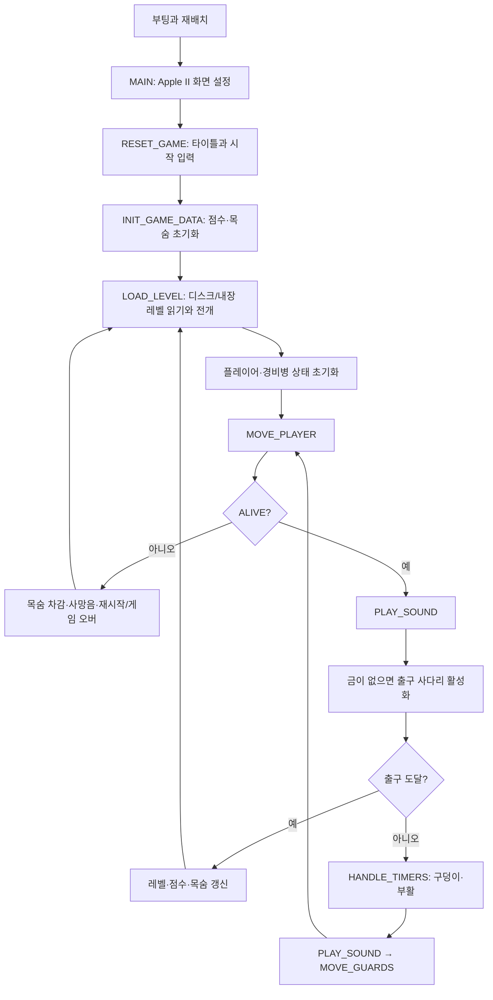

# Lode Runner 메인 로직과 I/O 경계

이 문서는 `apple2/main.nw`의 실행 경로를 따라 포팅에 필요한 상태와 I/O 경계를 정리한다. 원본의 메모리 주소는 상태의 역할을 확인하기 위한 기준이며, 네이티브 구현에서 그대로 유지해야 하는 자료 구조를 뜻하지는 않는다.

## 실행 경로

실제 루프는 `apple2/main.nw`의 `INIT_GAME_DATA`와 `<<game loop>>`(약 8800–9010행)에 있다. 사망 뒤에는 게임 모드와 남은 목숨에 따라 타이틀/점수 화면으로 갈 수 있으므로 그림의 `N → E`는 재시작 경로만 단순화한 것이다. `PLAY_SOUND`는 정상 루프에 두 번 등장하며, 음을 재생하거나 지연을 수행한다. 따라서 루프의 호출 순서를 바꾸면 원작의 속도와 동작이 달라질 수 있다.

## 제로페이지: 상태와 작업 공간

6502의 A/X/Y 레지스터는 짧은 계산에 쓰이고, 제로페이지는 포인터·인자·게임 상태·작업용 레지스터 역할을 한다. 네이티브 포트에서는 **수명이 긴 상태와 함수 호출 중에만 유효한 작업값을 분리**해야 한다.

| 주소 | 원본 이름 | 역할과 수명 |
| --- | --- | --- |
| `$00`–`$05` | `PLAYER_COL/ROW`, `PLAYER_X/Y_ADJ`, `PLAYER_ANIM_STATE`, `PLAYER_FACING_DIRECTION` | 플레이어의 지속 상태. 보드 칸 좌표와 칸 안의 오프셋을 따로 보유한다. 오프셋 `2`가 정렬 위치이고 범위는 `0`–`4`다. |
| `$06`–`$09` | `PTR1`, `PTR2` | 현재 행의 논리 보드 포인터. `PTR1`은 움직이는 물체가 반영된 활성 보드(`$0800`–`$09BF`), `PTR2`는 배경 보드(`$0A00`–`$0BBF`)를 가리킨다. 호출 중 자주 다시 설정된다. |
| `$0C`–`$0F` | `ROW_ADDR`, `ROW_ADDR2` | Apple II HGR 화면 행 주소. 그리기 루틴의 임시 포인터다. |
| `$12`–`$19` | `GUARD_LOC_*`, `GUARD_*`, `GUARD_NUM` | 현재 처리 중인 경비병 한 명의 작업 상태. 전체 경비병 배열은 `$0C60` 부근에 따로 있다. `LOAD_GUARD_DATA`/`STORE_GUARD_DATA`가 두 표현을 오간다. |
| `$1B`–`$1F`, `$50`–`$51`, `$71`, `$DF`–`$FF` | 화면 행·열, `SPRITE_NUM`, `HGR_PAGE`, 마스크·시프트·`BLOCK_DATA` | 스프라이트 렌더러의 입력과 작업 공간. `$DF`–`$FF`는 33바이트의 시프트된 스프라이트 버퍼다. |
| `$53`–`$64` | 경비병 부활 위치, 음표 인덱스, AI 탐색 임시값, `GUARD_PATTERNS`, `GUARD_PHASE` | 부활·AI·사운드에 걸친 혼합 영역. `$55`/`$56`은 점수 화면 코드에서 다른 이름으로 재사용된다. `$5C`도 범용 scratch와 AI 임시값의 별칭이다. |
| `$85`–`$86` | `GAME_COLNUM/ROWNUM` | 여러 그리기 루틴에 넘기는 좌표. 플레이어의 지속 좌표와 구분한다. |
| `$8C`–`$94` | `FRAME_PERIOD`, 경비병/점수/레벨 관련 카운터, `GOLD_COUNT`, `DIDNT_PICK_UP_GOLD` | 프레임 속도, 점수(`$8E`–`$91`, BCD), 남은 금 등의 게임 상태. |
| `$95`–`$A7` | `INPUT_MODE`, `DISK_LEVEL_LOC`, `LIVES`, `ALIVE`, `DIG_DIRECTION`, `KEY_COMMAND`, `KEY_COMMAND_LR`, `LEVELNUM`, `GAME_MODE` 등 | 진행·입력·플레이어 행동 상태. `DISK_LEVEL_LOC`은 0부터, `LEVELNUM`은 1부터 센다. |

`$06`/`$08` 포인터와 `$85`/`$86` 좌표는 사실상 내부 호출 규약이다. 예를 들어 `DRAW_SPRITE_PAGE1/2`는 A의 스프라이트 번호와 `GAME_ROWNUM/GAME_COLNUM`을 받아 `HGR_PAGE`와 여러 렌더링 임시값을 바꾼다. 포팅 중 이를 전역 게임 상태로 그대로 복사하면 호출 순서에 따른 덮어쓰기를 놓치기 쉽다.

제로페이지 값만으로 호출 계약이 완성되지는 않는다. 이동 시도 루틴은 6502의 carry 플래그로 성공/실패를 돌려주며, 입력 제어키와 경비병 행동은 주소 테이블을 스택에 넣고 `RTS`로 분기한다. 일부 루틴은 명령어의 피연산자 자체도 바꾼다. 네이티브 코드로 옮길 때는 이 암묵적 출력과 수정되는 값을 명시적인 반환값·상태로 기록해야 한다.

## I/O 줄기

| 영역 | 메인 로직에서 들어오는 곳 | 원본 I/O | 포트의 경계 |
| --- | --- | --- | --- |
| 입력 | `MOVE_PLAYER → CHECK_FOR_INPUT` | `$C000` 키보드, `$C010` 스트로브 해제; `$C061/$C062` 버튼; `$C064/$C065/$C070` 패들 | 키/조이스틱을 원본의 `KEY_COMMAND`와 `KEY_COMMAND_LR` 의미로 정규화한다. 이동은 `I/J/K/L`, 좌우 굴착은 `U/O`다. `MOVE_PLAYER`는 굴착 지속과 낙하를 먼저 처리하므로 입력이 매 루프마다 반드시 적용되지는 않는다. |
| 논리 보드 | `LOAD_LEVEL → DRAW_LEVEL_PAGE2`, 이동·충돌·타이머·AI | `$0800`–`$0BBF`의 활성/배경 28×16 스프라이트 보드 | 두 보드의 역할을 분리한다. 충돌과 금 수집은 화면 픽셀이 아니라 이 보드를 읽는다. |
| 화면 | 레벨·플레이어·경비병·구덩이·UI 그리기 | `$2000`/`$4000` HGR 페이지, `$C050/$C052/$C054/$C055/$C057` 화면 스위치 | 논리 보드 변경과 화면 표시를 별도 단계로 둔다. HGR의 행 주소, 색상, 페이지 전환은 화면 백엔드로 모은다. |
| 사운드와 시간 | 정상 루프의 `PLAY_SOUND` 두 번, 동작 중 효과음 | `$C030` 스피커 토글과 CPU 사이클 기반 지연 | 음표/효과음 요청과 게임 진행 시간을 분리해 모델링하되 원본의 호출 순서를 기준 동작으로 기록한다. `FRAME_PERIOD`는 속도 조절 상태다. |
| 레벨 저장소 | `LOAD_LEVEL → ACCESS_COMPRESSED_LEVEL_DATA` | `$0D00`의 256바이트 버퍼, DOS RWTS 섹터 I/O | 0부터 세는 레벨 인덱스로 256바이트를 읽고 쓴다. 각 레벨의 앞 224바이트는 28×16칸을 4비트씩 담는다. 타이틀/시연 모드는 첫 세 레벨을 메모리에서 읽는다. |
| 점수 저장소 | 시작·게임 오버·에디터 | RWTS로 별도 점수 섹터 읽기/쓰기 | 점수표 영속화 인터페이스로 분리한다. 원본의 마스터/데이터 디스크 판별은 에디터 동작에 영향을 준다. |

## 한 루프의 상태 변화

1. `MOVE_PLAYER`가 금 수집 플래그를 초기화한다. 굴착 중이면 계속 굴착하고, 그렇지 않으면 사다리/로프/발밑 보드를 검사해 낙하 여부를 결정한다. 낙하하지 않을 때 `CHECK_FOR_INPUT`이 키나 패들을 `KEY_COMMAND`(상하/굴착)와 `KEY_COMMAND_LR`(좌우)로 바꾼다. 이동 루틴은 활성·배경 보드를 검사하고 플레이어 위치와 화면을 갱신한다.
2. `ALIVE`가 0이면 사망 처리로 간다. 살아 있으면 사운드 한 구간을 재생/지연한다.
3. `GOLD_COUNT`가 0이면 출구 사다리를 활성화한다. 플레이어가 맨 윗줄의 정렬 위치에 있고 금이 0개 또는 특수값 `$FF`이면 레벨을 마친다.
4. `HANDLE_TIMERS`가 경비병 부활과 파낸 벽돌의 복구를 처리한다. 벽돌이 플레이어 자리에 복구되면 `ALIVE`를 0으로 바꿀 수 있다.
5. 다시 사운드 한 구간을 처리하고 `MOVE_GUARDS`를 실행한다. AI는 3단계 `GUARD_PHASE`와 비트 패턴으로 이번 루프에 어느 경비병을 움직일지 정한다. 각 경비병의 상태는 배열에서 제로페이지 작업 영역으로 불러왔다가 저장한다. 충돌로 `ALIVE`가 0이 될 수 있다.

## 포팅 시 먼저 고정할 계약

1. **레벨 디코더와 보드 상태:** 원본 256바이트 레벨을 28×16 두 보드로 전개하고 스프라이트 번호·플레이어·경비병·금 개수를 확인한다. 첫 기준 자료는 `apple2/disk/track_03.asm`의 첫 섹터와 `apple2/main.nw`의 `LEVEL1_DATA`다. 둘은 용도가 다르므로 같은 바이트열이라고 가정하지 않는다.
2. **한 번의 게임 단계:** 입력 명령, 두 보드, 플레이어/경비병/타이머 상태를 받아 위 순서대로 변화시키는 단위를 정의한다. `PLAY_SOUND`가 현재 지연도 담당한다는 점 때문에 네이티브 시간 간격은 원본 호출 결과를 관찰하면서 정해야 한다.
3. **I/O 어댑터:** 입력 샘플, 화면 출력, 음향, 레벨/점수 저장소를 코어 밖으로 둔다. 첫 구현에서는 원본 키 명령과 원본 레벨 섹터를 그대로 코어에 전달하면 차이를 추적하기 쉽다.

### 근거 위치

- 게임 루프와 초기화: `apple2/main.nw` 약 8789–9020행
- 입력 변환: 약 4700–4770행, 5135–5277행
- 플레이어 이동: 약 6099–6256행
- 경비병 단계: 약 6692–6760행
- 보드 행 포인터·그리기: 약 2348–2450행, 810–909행
- 레벨 I/O와 전개: 약 3425–3745행
- 타이머: 약 4116–4290행
- 사운드/속도: 약 1712–1803행
